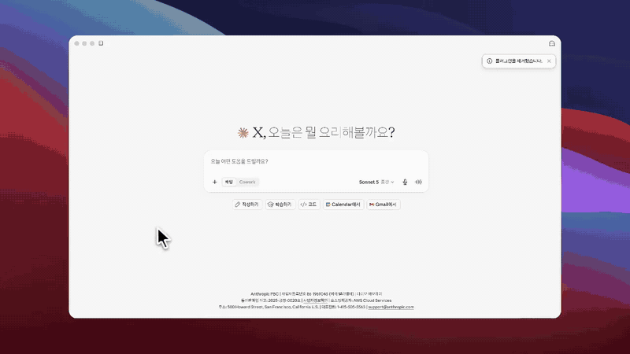

# ODA Intelligence Plugin

[한국어](README.md) | [English](README.en.md)

Public Claude, Codex, and ChatGPT packaging for evidence-based development
cooperation research.

The plugin installs three Skills and connects exactly one public, read-only MCP
gateway:

```text
https://oda-mcp.fly.dev/oda-intelligence/v2/mcp
```

One gateway provides international aid and country data, Korean ODA project locations, KOICA regulations, and development indicators. Users do not need credentials.

This repository contains no source-server implementation, deployment secret,
private Git history, or local credential store. Its only runtime dependency is
the public MCP contract.

## Claude

Add `amnotyoung/oda-intelligence-plugin` as a personal plugin marketplace, then
install `ODA Intelligence`.

After a marketplace sync or plugin update, start a new Claude conversation.
Existing conversations can retain the tool snapshot they had when they were
created. In the plugin details, the expected installed components are:

- three Skills;
- one connector named `oda-intelligence`;
- the read-only tools supplied by that connector.

If only the three Skills appear, sync the marketplace, update or reinstall the
plugin, and create another new conversation. The Skills do not call a hidden
backend on their own; they require the bundled connector.

Claude Code:

```bash
claude plugin marketplace add amnotyoung/oda-intelligence-plugin
claude plugin install oda-intelligence@oda-intelligence-plugin
```

This desktop installation demo shows an earlier version. The current version installs three Skills.



## Codex

Add the public GitHub repository as a Codex marketplace source, then install
the plugin:

```bash
codex plugin marketplace add amnotyoung/oda-intelligence-plugin
codex plugin add oda-intelligence@oda-intelligence-plugin
```

After installing, open a new task and try the [Timor-Leste exercise](#check-your-installation). The plugin registers the public `oda-intelligence` MCP server for you.

For local development, run the commands from the repository root and replace
the repository argument with `.`:

```bash
codex plugin marketplace add .
codex plugin add oda-intelligence@oda-intelligence-plugin
```

To update an installation from GitHub, refresh the marketplace and reinstall
the plugin:

```bash
codex plugin marketplace upgrade oda-intelligence-plugin
codex plugin add oda-intelligence@oda-intelligence-plugin
```

After changing the local source, update the plugin version or Codex cachebuster
and run `codex plugin add` again. Start a new task after installation or
reinstallation so Codex loads the updated Skills and MCP configuration.

## ChatGPT

The complete plugin combines the three bundled Skills with the registered
`ODA Intelligence` MCP app. The committed `.app.json` contains the app's
technical identifier, not a credential or authentication token.

For maintainer testing, enable ChatGPT developer mode, add this repository as a
personal marketplace source, and install `ODA Intelligence`. The registered app
uses the gateway URL above with no authentication.

This developer-mode package is not yet a public directory release. Universal
ChatGPT distribution requires a **With MCP** directory submission of the same
gateway; a Skills-only submission would intentionally omit the app mapping.

ChatGPT keeps an approved snapshot of tool definitions. Compatible data and
server behavior changes are available at the same URL, while a new tool-contract
version must be reviewed and refreshed by a workspace administrator.

## Check your installation

After installing the plugin, open a new conversation (a new task in Codex) and paste this question:

> Use ODA Intelligence to look up the maternal mortality ratio in Timor-Leste. Give the WHO GHO estimate, its uncertainty interval, the unit, and the reference year.

Open the `country_report_context` or `country_humanitarian_context` call from the `oda-intelligence` server. A WHO GHO maternal mortality ratio for Timor-Leste (`TL`) in the tool response confirms the connection. On 9 November 2026, WHO GHO returned a **2023 estimate of 192 maternal deaths per 100,000 live births (uncertainty interval 125–288)**. The estimate and reference year may change as the source is updated.

If you don't see a tool call, check that the `oda-intelligence` connector is enabled in the plugin details, then try the question in a new conversation.

## Public catalog of 22 tools

For maternal, neonatal or under-five mortality in a given year, request the country, indicator and year. Check the source URL, retrieval time, unit and original row. Use regulation discovery and citation checks with the official publication for full text. Country summaries mark credential-dependent feeds as disabled.

- **Development and health indicators** · `country_indicator_data_status`, `get_country_indicator_snapshot`, `search_development_indicator_catalog`, `get_health_observation_by_year`
- **Korean project map** · `oda_map_country_context`, `oda_map_data_status`, `oda_map_project_detail`, `oda_map_projects`
- **OECD development finance** · `dac_purpose_code_lookup`, `oecd_crs_query_country`
- **Country, hazard and humanitarian context** · `country_data_status`, `country_hazard_snapshot`, `country_humanitarian_context`, `country_list`, `country_map_outline`, `country_report_context`
- **KOICA regulations** · `compliance_radar`, `find_references`, `list_attachments`, `list_sources`, `search_regulation`, `verify_citation`

### Korean ODA projects — `korean-oda-map`

Korean development cooperation projects and their locations. Start with the
status tool; it reports the source and correction layers separately.

| Tool | What it returns | Inputs |
|---|---|---|
| `oda_map_data_status` | Layer state (`fresh`, `stale`, `no_data`, `disabled`, `error`), cache time, record count, coverage | `country` |
| `oda_map_country_context` | Report-ready country summary: portfolio, agencies, sectors, map layers, locations. Separates map pins from unique projects and recalculates status against `as_of`. Carries no hazard, security, or travel data | **`country`**, `as_of`, `sections`, `sample_limit`, `include_coordinates` |
| `oda_map_projects` | Search, filter, and page a country's projects. A multi-location project is counted once by activity identifier, with its sites kept in `locations` | **`country`**, `query`, `agency`, `sector`, `status`, `layers`, `as_of`, `limit`, `offset`, `fields`, `include_coordinates` |
| `oda_map_project_detail` | One project by identifier, or by a location-suffixed map entity ID. Reports multi-location spread, budget duplication, source-layer state, and as-of status separately | **`project_id`**, `country`, `as_of`, `include_coordinates` |

> Summarise the health projects Korean agencies run in Myanmar, and name the
> source the list came from.

```text
oda_map_data_status    { "country": "미얀마" }
oda_map_projects       { "country": "미얀마", "sector": "보건", "limit": 3 }
oda_map_project_detail { "project_id": "iati:KR-GOV-110-201917011048" }
```

`status` accepts `active`, `ended`, `planned`, or `unknown`, and it is derived
from `as_of` rather than stored, so a portfolio count is only meaningful next
to the date it was computed for.

### International context — `international-data`

| Tool | What it returns | Inputs |
|---|---|---|
| `dac_purpose_code_lookup` | Official OECD SDMX `CL_DAC_SECTOR` entries: 3-digit DAC sectors, 5-digit CRS purpose codes, parent relationships, and codelist version | `code`, `query`, `includeChildren`, `limit`, `refresh` |
| `country_data_status` | Observation, collection, and cache dates, record counts, errors, and freshness across IATI, World Bank, OECD, hazard, HAPI, UNHCR, WHO, and ReliefWeb | **`countryCode`**, `refresh` |
| `country_indicator_data_status` | Country indicator availability and provider status | **`countryCode`** (ISO3) |
| `search_development_indicator_catalog` | Search definitions, units and stable IDs across 42 World Bank indicators and one WHO GHO indicator | `query`, `source`, `limit` |
| `get_country_indicator_snapshot` | Country observations, reference years, units, sources and missing-data status for selected indicators | **`countryCode`** (ISO3), **`indicatorIds`** (up to 20) |
| `country_report_context` | Report-ready context in one call: source status, counts, and three samples per source | **`countryCode`**, `sampleSize`, `fields`, `refresh` |
| `country_humanitarian_context` | Structured HDX HAPI, UNHCR, and WHO GHO observations, plus recent ReliefWeb and World Bank document metadata | **`countryCode`**, `sampleSize`, `fields`, `refresh` |
| `country_hazard_snapshot` | USGS, GDACS, and NASA EONET events clipped to the country boundary, de-duplicated by same type within 100 km and 48 hours | **`countryCode`**, `sampleSize`, `includeEvents`, `fields`, `refresh` |
| `country_list` | KOICA overseas-office host and concurrent countries with ISO codes, responsible office, and jurisdiction role | (none) |
| `country_map_outline` | Simplified country outline for a report base map. Geographic context for placing project sites, not a boundary determination | **`countryCode`** |

### KOICA regulations — `koica-regulations`

| Tool | What it returns | Inputs |
|---|---|---|
| `search_regulation` | Regulation metadata and article snippets with a relevance score. `include_attachments: true` searches annex tables and forms (별표·별지) too, and `mode` picks hybrid (default), keyword, or semantic retrieval | **`query`**, `category`, `source`, `limit`, `fuzzy`, `include_attachments`, `mode` |
| `list_sources` | The indexed current regulations with category, revision date, and article count | `category` |
| `list_attachments` | The annex/form index (별표·별지) with titles and excerpts, filterable by regulation, category, and kind. Truncates to the response budget; `total` always states the true count | `source`, `category`, `kind`, `include_deleted` |
| `find_references` | Citation graph for one article: what it cites (`outgoing`) and what cites it (`incoming`), each marked `same_regulation`, `cross_regulation`, or `external`. `include_mermaid: true` adds a flowchart of the graph. An article that is not found returns an empty graph, not an error | **`source`**, **`article`**, `limit`, `include_mermaid` |
| `compliance_radar` | Revision-lag radar: flags implementation rules and guidelines whose parent regulation was revised more recently (`review_needed` / `ok` / `unknown` / `no_parent`) | `source` |
| `verify_citation` | Cross-checks every `{regulation} 제N조` citation in a text against the index and marks each `ok`, `not_found`, or `unknown_source` | **`text`** |

## Controlled updates

- Data and compatible server behavior change at the remote services without a
  plugin update.
- The versioned `v2` endpoint fixes the approved tool surface. Tool names,
  required inputs, required outputs, read-only guarantees, and forbidden
  high-exposure tools are checked against `contracts/gateway-contract.json`.
- The daily check and its update PR use the built-in GitHub Actions token. The job checks the live gateway and runs package tests, a dependency audit, and a version check on changes.
- A daily workflow auto-merges generated lock metadata updates only when the
  exact tool contract hashes stay unchanged. Tool schema/detail hash drift is
  left as an open pull request for human review.
- Breaking contract drift fails instead of rewriting the accepted contract.
- Skill routing and accepted contract changes require a versioned plugin
  update; installed caches still need a marketplace upgrade and a new
  conversation.

## Data-use notice

The plugin routes requests to external data services. Source availability,
licensing, confidentiality, and reuse conditions remain governed by the
relevant source and operator. Do not treat a public MCP endpoint as proof that
every returned document is cleared for unrestricted redistribution.

## Related tooling

[DevEval Agents](https://github.com/amnotyoung/dev-eval-agents) — a
multi-agent OECD-DAC evaluation framework by the same maintainer — uses this
gateway as an optional evidence source: country context for relevance and
coherence ratings, the Korean ODA map for duplication checks, and
`verify_citation` for regulation citations in evaluation reports. The
integration is one-way and optional; this plugin does not depend on it, and
its tool surface is unchanged by it.

## Development

```bash
npm ci
npm test
npm run contracts:check
```

Source code is licensed under the [Apache License 2.0](LICENSE). Data returned
by MCP tools is not relicensed by this repository. See the
[privacy notice](PRIVACY.md) and [terms of use](TERMS.md).
