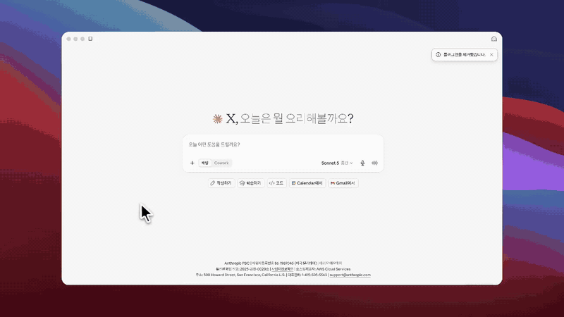

# ODA Intelligence Plugin

[한국어](README.md) | [English](README.en.md)

**ODA Intelligence**는 한국 ODA 사업 위치, OECD 개발재원, WHO·World Bank 지표, 재난·인도지원 현황과 KOICA 규정을 조회하는 플러그인입니다. 공개판 0.2.39에는 읽기 전용 도구 22개와 조사 스킬 3개가 있습니다. 게이트웨이는 개인 API 키 없이 쓸 수 있습니다. Claude, Codex, Antigravity, ChatGPT에서 설치할 수 있습니다.

사용하는 앱에 플러그인을 설치한 뒤, 동티모르의 보건지표를 조회해 연결을 확인하세요.

[Claude 설치](#claude) · [Codex 설치](#codex) · [ChatGPT 이용 조건](#chatgpt) · [첫 조회 예시](#첫-조회로-연결-확인)

원격 MCP를 직접 등록하는 앱에서는 서버 이름을 `oda-intelligence`로 지정하고 다음 주소를 입력합니다.

```text
https://oda-mcp.fly.dev/oda-intelligence/v2/mcp
```

## Claude

`amnotyoung/oda-intelligence-plugin`을 개인 플러그인 마켓플레이스로 추가한
다음 `ODA Intelligence`를 설치합니다.

마켓플레이스를 동기화하거나 플러그인을 업데이트한 뒤에는 새 Claude 대화를
시작하세요. 기존 대화에는 대화 생성 시점의 도구 스냅샷이 남아 있을 수 있습니다.
플러그인 상세 화면에는 다음 구성 요소가 설치된 것으로 표시되어야 합니다.

- Skill 세 개
- `oda-intelligence`라는 이름의 커넥터 한 개
- 해당 커넥터가 제공하는 읽기 전용 도구

Skill 세 개만 표시된다면 마켓플레이스를 동기화하고 플러그인을 업데이트하거나
재설치한 뒤 새 대화를 시작하세요. Skill 자체는 숨겨진 백엔드를 호출하지 않으며,
번들로 제공되는 커넥터가 필요합니다.

Claude Code:

```bash
claude plugin marketplace add amnotyoung/oda-intelligence-plugin
claude plugin install oda-intelligence@oda-intelligence-plugin
```

이전 버전의 데스크톱 설치 영상입니다. 현재 버전은 Skill 세 개를 설치합니다.



## Codex

공개 GitHub 저장소를 Codex 마켓플레이스 소스로 추가한 뒤 플러그인을
설치합니다.

```bash
codex plugin marketplace add amnotyoung/oda-intelligence-plugin
codex plugin add oda-intelligence@oda-intelligence-plugin
```

설치한 뒤 새 작업을 열고 [첫 조회 예시](#첫-조회로-연결-확인)를 따라 해 보세요. 플러그인이 공개 MCP 서버 `oda-intelligence`를 함께 등록합니다.

로컬 개발 시에는 저장소 루트에서 저장소 인자를 `.`으로 바꿉니다.

```bash
codex plugin marketplace add .
codex plugin add oda-intelligence@oda-intelligence-plugin
```

GitHub 설치본을 업데이트할 때는 마켓플레이스를 갱신한 뒤 플러그인을 다시
설치합니다.

```bash
codex plugin marketplace upgrade oda-intelligence-plugin
codex plugin add oda-intelligence@oda-intelligence-plugin
```

로컬 소스를 수정한 경우에는 플러그인 버전 또는 Codex 캐시버스터를 갱신한 뒤
`codex plugin add`를 다시 실행하세요. 설치 또는 재설치 후 새 작업을 시작해야
Codex가 갱신된 Skill과 MCP 구성을 불러옵니다.

## Antigravity

Google Antigravity에서는 `agy` CLI(1.3.3 이상)로 GitHub 저장소를 바로
설치합니다.

```bash
agy plugin install https://github.com/amnotyoung/oda-intelligence-plugin
```

`agy`는 저장소의 `plugins/` 폴더에서 `oda-intelligence`를 찾아 Antigravity
매니페스트(`.antigravity-plugin/plugin.json`)와 MCP 설정(`mcp_config.json`)으로
설치합니다. Skill 세 개는 Claude·Codex 패키지와 같은 `skills/` 폴더를 씁니다.
게이트웨이는 Antigravity 원격 MCP 형식인 `serverUrl`로 연결되며, 에이전트에는
`oda-intelligence_oda-intelligence`라는 서버 이름으로 표시됩니다.

설치 결과는 다음 명령으로 확인합니다.

```bash
agy plugin list
```

`oda-intelligence (enabled, …)`, `Source: antigravity`,
`3 skills, 1 MCP server`가 보여야 합니다. 처음 도구를 호출할 때 MCP 권한 승인
창이 뜨면 허용하세요. 업데이트할 때는 같은 `agy plugin install` 명령을 다시
실행한 뒤 새 대화를 시작합니다.

로컬 사본에서는 저장소 루트에서 플러그인 폴더를 지정합니다.

```bash
agy plugin install ./plugins/oda-intelligence
```

CLI 없이 도구만 연결하려면 Antigravity MCP 설정(`mcp_config.json`)의
`mcpServers`에 다음 항목을 추가합니다. 이 방법은 Skill을 설치하지 않습니다.
원격 서버 주소는 `serverUrl`에 적어야 하며, `httpUrl`은 지원되지 않습니다.

```json
{
  "mcpServers": {
    "oda-intelligence": {
      "serverUrl": "https://oda-mcp.fly.dev/oda-intelligence/v2/mcp"
    }
  }
}
```

## ChatGPT

**게이트웨이 도구 연결.** ChatGPT 웹에서 사용자 지정 MCP 서버를 추가할 권한이 있으면
`Plugins → + → Add custom MCP server`를 엽니다. 이름은 `oda-intelligence`로 지정하고,
위의 게이트웨이 URL을 입력한 뒤 인증 방식으로 `None`을 선택합니다. 연결을 생성하고
설치한 다음 새 대화에서 첫 조회를 실행하세요. [OpenAI 연결 안내](https://help.openai.com/en/articles/12584461-connecting-custom-mcp-servers-in-chatgpt)

**조사 스킬 3개를 포함한 패키지 설치.** 워크스페이스 관리자는
`Admin → Plugins → Add → Import marketplace`에서 이 저장소의 URL을 입력하고
`Path`를 비워 둡니다. 가져오기가 끝나면 등록된 MCP 앱의 접근 권한을 확인하세요.
구성원은 워크스페이스의 플러그인 목록에서 `ODA Intelligence`를 설치할 수 있습니다.
[OpenAI 마켓플레이스 가져오기 안내](https://learn.chatgpt.com/docs/enterprise/plugin-management)

공개 디렉터리에 제출할 때는 게이트웨이를 포함하는 **With MCP** 유형을 사용합니다.
[OpenAI 제출 안내](https://developers.openai.com/plugins/deploy/submission)

워크스페이스에서 승인한 사용자 지정 MCP 연결은 도구 정의의 스냅샷을 유지합니다.
도구 정의가 바뀌면 관리자가 변경 사항을 검토하고 도구 목록을 갱신합니다.

## 첫 조회로 연결 확인

설치한 뒤 새 대화에서 다음 질문을 보내세요.

> ODA Intelligence로 동티모르의 2019년 신생아 사망률을 조회해줘.

1. 실행 기록에서 `get_health_observation_by_year` 호출을 엽니다. 입력은 국가 `TLS`, 지표 `WB:SH.DYN.NMRT`, 연도 `2019`입니다.
2. 응답의 `api_url`을 열고 World Bank 원본 행의 `date`와 `value`를 대조합니다. 2026년 11월 19일 조회값은 **출생아 1,000명당 23.5명**이었습니다. [World Bank 공식 응답](https://api.worldbank.org/v2/country/TLS/indicator/SH.DYN.NMRT?date=2019&format=json)
3. 보고서에는 관측연도(`year`)와 조회 시각(`fetched_at`)을 함께 기록합니다. 같은 2019년 값도 자료가 개정되면 바뀔 수 있습니다.

호출 기록이 보이지 않으면 앱에서 `oda-intelligence` 연결을 확인한 뒤 새 대화에서 다시 실행하세요.

## 공개 도구 22개

특정 연도의 모성·신생아·5세 미만 사망률은 국가·지표·연도를 지정해 요청합니다. 응답의 공식 URL, 수집 시각, 단위, 원본 행을 확인하세요. 규정은 목록·검색·인용으로 찾고 전문은 공식 공시에서 확인합니다. 국가 종합조회에서 IATI Datastore, 외교부 여행경보, HDX HAPI, ReliefWeb, ACLED는 `disabled`로 표시됩니다. 이 표시는 해당 자료원을 조회하지 않았다는 뜻입니다.

- **개발지표와 보건통계** · `country_indicator_data_status`, `get_country_indicator_snapshot`, `search_development_indicator_catalog`, `get_health_observation_by_year`
- **한국 ODA 지도** · `oda_map_country_context`, `oda_map_data_status`, `oda_map_project_detail`, `oda_map_projects`
- **OECD 개발재원** · `dac_purpose_code_lookup`, `oecd_crs_query_country`
- **국가·재난·인도지원** · `country_data_status`, `country_hazard_snapshot`, `country_humanitarian_context`, `country_list`, `country_map_outline`, `country_report_context`
- **KOICA 규정** · `compliance_radar`, `find_references`, `list_attachments`, `list_sources`, `search_regulation`, `verify_citation`

### 한국 ODA 사업 — `korean-oda-map`

한국 개발협력 사업과 그 위치를 다룹니다. 상태 도구부터 호출하세요. 원천 레이어와
승인 보정 레이어의 상태를 분리해 보고합니다.

| 도구 | 무엇을 반환하는가 | 입력 |
|---|---|---|
| `oda_map_data_status` | 레이어 상태(`fresh`, `stale`, `no_data`, `disabled`, `error`), 캐시 시각, 레코드 수, 커버리지 | `country` |
| `oda_map_country_context` | 국가별 사업·기관·위치 현황 요약. 지도 핀 수와 고유 사업 수를 구분하고 사업 상태를 `as_of` 기준으로 다시 계산합니다. 실시간 재난·치안·여행경보는 포함하지 않습니다 | **`country`**, `as_of`, `sections`, `sample_limit`, `include_coordinates` |
| `oda_map_projects` | 국가의 사업을 검색·필터·페이지 처리합니다. 다중 위치 사업은 활동 식별자 기준으로 한 번만 집계하고 위치는 `locations`에 보존합니다 | **`country`**, `query`, `agency`, `sector`, `status`, `layers`, `as_of`, `limit`, `offset`, `fields`, `include_coordinates` |
| `oda_map_project_detail` | 사업 식별자 또는 위치 접미사가 붙은 지도 entity ID로 사업 상세를 조회합니다. 다중 위치, 예산 중복, 원천 레이어 상태, 기준일 상태를 분리해 반환합니다 | **`project_id`**, `country`, `as_of`, `include_coordinates` |

> 미얀마에서 한국 기관들이 하는 보건 사업을 정리하고, 어느 출처에서 나온
> 목록인지 밝혀줘.

```text
oda_map_data_status    { "country": "미얀마" }
oda_map_projects       { "country": "미얀마", "sector": "보건", "limit": 3 }
oda_map_project_detail { "project_id": "iati:KR-GOV-110-201917011048" }
```

`status`는 `active`, `ended`, `planned`, `unknown` 중 하나이며 저장된 값이 아니라
`as_of`로 다시 계산한 값입니다. 따라서 사업 건수는 어느 기준일로 계산했는지와
함께 제시해야 의미가 있습니다.

### 국제 현황 — `international-data`

아래 표의 ISO2와 ISO3는 각각 두 자리와 세 자리 국가코드입니다. 동티모르는 ISO2가 `TL`, ISO3가 `TLS`입니다. 공개 게이트웨이는 서버에서 캐시를 관리하므로 `refresh`는 생략하거나 `false`로 지정합니다.

| 도구 | 무엇을 반환하는가 | 입력 |
|---|---|---|
| `dac_purpose_code_lookup` | 게이트웨이 API로 3자리 DAC 분야와 5자리 CRS 목적코드, 상위 코드, 코드표 판본을 조회합니다. 코드와 명칭의 원본은 OECD 통합문서의 `Purpose codes` 시트이며, 응답의 `cache_hit`은 캐시 사용 여부를 나타냅니다. [DAC-CRS-CODES.xlsx](https://webfs.oecd.org/oda/DataCollection/Resources/DAC-CRS-CODES.xlsx) | `code`, `query`, `includeChildren`, `limit`, `refresh` |
| `oecd_crs_query_country` | 한국이 특정 수원국·연도에 보고한 OECD CRS 자료 | **`countryCode`** (ISO2), **`year`**, `sectorCode`, `flowType`, `breakdown`, `limit`, `refresh` |
| `get_health_observation_by_year` | 지정 연도의 WHO 모성사망비 또는 World Bank 신생아·5세 미만 사망률. 공식 응답 행, 단위, URL과 조회 시각 포함 | **`country`** (ISO3), **`indicator`**, **`year`** |
| `country_data_status` | World Bank·OECD·재난·UNHCR·WHO 문서의 관측일·수집일·캐시일·건수·오류·최신성 요약 | **`countryCode`** (ISO2), `refresh` |
| `country_indicator_data_status` | 국가별 개발지표 가용성 및 출처별 조회 상태 | **`countryCode`** (ISO3), `refresh` |
| `search_development_indicator_catalog` | 세계은행 42개·WHO GHO 1개 지표에서 정의, 단위, 안정 ID 검색 | `query`, `source`, `limit` |
| `get_country_indicator_snapshot` | 선택한 지표의 국가별 관측값·기준연도·단위·출처·결측 상태 | **`countryCode`** (ISO3), **`indicatorIds`** (최대 20개), `refresh` |
| `country_report_context` | 보고서용 정제 데이터를 한 번에 반환합니다. 기본은 출처 상태·건수·출처별 표본 3건입니다 | **`countryCode`** (ISO2), `sampleSize`, `fields`, `refresh` |
| `country_humanitarian_context` | UNHCR·WHO GHO의 관측치와 World Bank 최신 문서 메타데이터 | **`countryCode`** (ISO2), `sampleSize`, `fields`, `refresh` |
| `country_hazard_snapshot` | USGS·GDACS·NASA EONET 사건을 국가 경계로 거른 뒤 같은 유형·100㎞·48시간 기준으로 중복 제거한 결과 | **`countryCode`** (ISO2), `sampleSize`, `includeEvents`, `fields`, `refresh` |
| `country_list` | KOICA 해외사무소 소재국·겸임국을 ISO 코드, 담당 사무소, 관할 역할과 함께 반환 | (없음) |
| `country_map_outline` | 보고서 배경용 단순화 국가 윤곽선. 사업 위치를 얹을 지리 맥락일 뿐 경계 확정이 아닙니다 | **`countryCode`** (ISO2) |

### KOICA 규정 — `koica-regulations`

| 도구 | 무엇을 반환하는가 | 입력 |
|---|---|---|
| `search_regulation` | 규정 메타데이터와 조문 스니펫, 적합도 점수. `include_attachments: true`면 별표·별지도 함께 검색하고, `mode`로 hybrid(기본)·keyword·semantic 검색을 고릅니다 | **`query`**, `category`, `source`, `limit`, `fuzzy`, `include_attachments`, `mode` |
| `list_sources` | 색인된 현행 규정 목록. 규정 유형, 개정일, 조문 수 포함 | `category` |
| `list_attachments` | 별표·별지 목록을 제목·발췌와 함께 반환하며 규정·유형·종류로 필터링합니다. 응답 예산에 맞춰 잘리지만 `total`이 언제나 실제 총계를 담습니다 | `source`, `category`, `kind`, `include_deleted` |
| `find_references` | 조문 하나의 인용 관계 그래프. 이 조문이 인용한 곳(`outgoing`)과 이 조문을 인용한 곳(`incoming`)을 각각 `same_regulation`, `cross_regulation`, `external`로 표시합니다. `include_mermaid: true`면 인용망 flowchart 코드가 함께 실립니다. 조문을 찾지 못해도 오류가 아니라 빈 그래프를 반환합니다 | **`source`**, **`article`**, `limit`, `include_mermaid` |
| `compliance_radar` | 정비 레이더 — 모규정이 더 최근에 개정된 시행세칙·지침을 `review_needed` / `ok` / `unknown` / `no_parent`로 플래그합니다 | `source` |
| `verify_citation` | 텍스트 안의 모든 `{규정명} 제N조` 인용을 색인과 대조해 `ok`, `not_found`, `unknown_source`로 분류합니다 | **`text`** |

## 통제된 업데이트

- 데이터 및 호환되는 서버 동작은 플러그인을 업데이트하지 않아도 원격
  서비스에서 변경될 수 있습니다.
- 버전이 지정된 `v2` 엔드포인트는 승인된 도구 표면을 고정합니다. 도구 이름,
  필수 입력, 필수 출력, 읽기 전용 보장 및 노출 위험이 높아 금지된 도구는
  `contracts/gateway-contract.json`을 기준으로 검사합니다.
- 일일 점검과 갱신 PR은 GitHub Actions 기본 토큰을 사용합니다. 점검 작업 안에서 게이트웨이를 조회하고 변경 패키지의 테스트·의존성 감사·버전 검사를 실행합니다.
- 일일 점검에서 호환성 검사를 통과한 변경이 `observed.lock.json`에 생기면 패치 버전을 올립니다.
  도구 계약 해시와 게이트웨이 식별 정보 등 자동 병합 조건이 유지되면 PR을 squash 병합하고,
  도구 스키마나 세부 제약의 해시가 바뀌면 PR을 열어 두어 관리자가 검토합니다.
- 호환성을 깨뜨리는 계약 변경이 감지되면 승인된 계약을 다시 작성하지 않고
  검사에 실패합니다.
- Skill 라우팅 또는 승인된 계약을 변경하려면 버전이 지정된 플러그인
  업데이트가 필요하며, 설치된 캐시를 갱신하려면 marketplace upgrade 후 새
  대화를 시작해야 합니다.

## 데이터 이용 안내

이 플러그인은 요청을 외부 데이터 서비스로 전달합니다. 출처의 가용성, 라이선스,
기밀성 및 재사용 조건에는 각 출처와 운영자의 정책이 적용됩니다. 공개 MCP
엔드포인트라는 이유만으로 반환된 모든 문서가 제한 없이 재배포할 수 있다고
간주하지 마세요.

## 개발

```bash
npm ci
npm test
npm run contracts:check
```

Antigravity 패키지는 `agy plugin validate plugins/oda-intelligence`로 검사합니다.
`--strict`를 붙이면 Claude Code용 `.mcp.json`이 같은 폴더에 있어 경고 한 건으로
실패합니다. Antigravity는 이 파일을 읽지 않으며, Claude 패키지에는 필요한
파일이므로 이 경고는 예상된 결과입니다.

소스 코드는 [Apache License 2.0](LICENSE)에 따라 제공됩니다. MCP 도구가
반환하는 데이터에 이 저장소의 라이선스가 새로 적용되는 것은 아닙니다.
[개인정보 처리방침](PRIVACY.md)과 [이용약관](TERMS.md)을 확인하세요.
